# plan_form_v2: formr's survey engine, v2

Branch: `feature/form_v2` (off `master` at v0.25.1). Not yet merged.

This file was originally a design spec. Phases 0–5 have since landed on the branch, so it has been rewritten to describe what exists, what doesn't, and what's next. Architectural decisions and the remaining-work list live here; day-to-day dev gotchas live in `CLAUDE.md` under "form_v2 development notes".

---

## Status as of 2026-09-03 — remaining

Everything else in this document describes shipped code. Still open, in rough priority order:

1. **Service-worker-side queue drain.** Not built. The queue drains from the page's `online` event, initial load and a retry timer only; the served SW (`webroot/assets/common/js/service-worker.js`) caches static assets and handles push, and leaves every other request to the browser. The page no longer registers a Background Sync tag or hands the SW a sync URL — a drain in the SW would need both, plus a worker on every v2 study (today only PWA runs register one). §5.1/§5.2, Phase 5.
2. **Queue wipe on PWA uninstall.** A logout wipes the run's queue (`wipeQueueForRun`, scoped to the run being logged out): the logout page itself (`logout.js`, `RunController::logoutAction`), and a logout link clicked on a form page. Uninstalling the PWA wipes nothing. §5.3.
3. **iOS Safari compatibility pass** for offline queue + PWA items — three iOS-only skips remain in the BrowserStack suite (two cache-population tests, one offline-submit test). §5.2, §8 P1.
4. **BS-reliable wiring for the date/time render smoke.** `tests/e2e/datetime-render.spec.js` covers date/time/datetime-local/month/week/yearmonth locally; on real devices it trips the same SDK reporter flake as the offline-submit test. §8 P2.
5. ~~**Example surveys ported to v2** — no importable Form-unit run bundle in `documentation/run_components/`.~~ **Done (2026-09-03):** `documentation/run_components/Form_v2_Basic.json` (Form unit + Endpage; the Form unit embeds `documentation/example_surveys/form_v2_basic.xlsx` as `survey_data`, so one import creates the study, links it and stamps `rendering_mode='v2'`). Form units round-trip through export/import like Survey units. Remaining, smaller: the *other* bundles (`Basic_Diary.json` et al.) are still engine-neutral Survey studies; porting one of those to a Form unit is optional polish. §8 P2.
6. **Rollout gates**: parity gate green, default flip to `rendering_mode='v2'` for new studies, `Survey` deprecation banner, hard `Survey` removal. §6.

---

## 1. Status at a glance

Phases 0–5 are code-complete on-branch (with gaps noted below). Phases 6 (docs + parity gate) and the rollout gates are still open.

| Phase | Status | Notes |
|---|---|---|
| 0 — Plumbing | ✅ done | `Form` RunUnit, `rendering_mode` column, `form_v2_enabled` flag |
| 1 — Single-page AJAX form | ✅ done | FormRenderer, Alpine, BS5, form-page-submit |
| 2 — Item-type coverage | ✅ done bar A/V smoke | PWA items wired vanilla; only audio/video need in-browser capture smoke |
| 3 — Client-side showif (JS only) | ✅ done | Alpine-driven; server-side R reaches a showif via a hidden item's `value` |
| 4 — Page-scoped value + label resolution | ✅ done | R in `value`; label slot for embedded Rmd, choice_label slot for R in choice labels, note_iframe via the label slot; every page (the first included) resolves via /form-render-page when shown; `calculate` is not supported in v2 (`Item::formV2Unsupported`) — a hidden item with the value, or R in the unit that uses it |
| 5 — Offline queue | ✅ done bar SW drain + iOS | page-JS enqueue/drain + `offline_mode` flag + file-blob queue (10 MB cap). The SW-side drain is registered but **not implemented** (no `sync` listener); iOS Safari pass still open |
| 6 — Docs + migration tooling + parity gate | ✅ mostly | admin compat-scanner UI, admin/operator docs (`documentation/form_v2.md`, `form_v2_upgrade.md`) and the v2 example study + run bundle all shipped; the v1↔v2 parity **suite** exists and runs (`tests/e2e/`) — what's still open is the *gate being green* (pwa_high fixture-permission skips + three iOS device skips). See §6 checklist. |
| Rollout gates | ⬜ open | parity gate, default flip, sunset |

What's live vs. gated:
- `form_v2_enabled` in `config/settings.php` gates the admin "Add Form" button (fa-wpforms icon). Once a `SurveyStudy` has `rendering_mode='v2'`, the v2 pipeline fires regardless of the flag — flipping the flag off does not disable existing v2 forms. To roll back a single form, flip its `rendering_mode` back to `'v1'`.
- Per-study flags (admin survey settings page, visible only for v2 studies): `offline_mode` (default on — IDB queueing on failure) and `allow_previous` (default off — "Previous" button between pages).
- The queue drain runs **page-side only**: `online` event, initial page load and a retry timer. A drain across tab/process death does not happen on any platform.

### Request-time flow

```mermaid
flowchart TB
  subgraph page["form_v2 page load"]
    A[Run::exec] -->|form_v2| B[RunSession::executeUnitSession]
    B -->|form_v2| C[RunController::indexAction]
    C -->|view=run/form_index| D[FormRenderer::render]
    D -->|data-fmr-fill-id| E[survey_r_calls lookup]
    D -->|data-fmr-label-id| E
    D -->|data-showif JS expr| F[Alpine fmrForm + x-showif]
  end
  subgraph submit["per-page submit"]
    G[submitPage] -->|JSON ok| H[POST form-page-submit]
    G -->|has file| I[POST form-page-submit multipart]
    G -->|fetch 5xx or offline| J[IndexedDB formrQueue]
    J -->|online event or next page load| K[POST form-sync]
    H --> L[UnitSession::updateSurveyStudyRecord]
    I --> L
    K --> L
  end
  subgraph reactive["server-side R cadence"]
    M[page shown: on load and after each submit] --> P[POST form-render-page]
    P --> Q[batch resolve slot=value, label, choice_label for that page]
    Q --> R[OpenCPU overlay on tail survey,1]
    S[showif] --> T[JS only - no server round trip]
  end
```



---

## 2. Architecture (frozen decisions)

### 2.1 Parallel Form RunUnit, `rendering_mode` flag

`Form` and `Survey` coexist. The data model (`survey_studies`, `survey_items`, `survey_item_choices`, `survey_items_display`, per-survey results tables) is shared — v2 writes through the same code paths (`UnitSession::createSurveyStudyRecord`, `UnitSession::updateSurveyStudyRecord`). The per-study `rendering_mode` ENUM (`'v1'` default, `'v2'`; patch 100) is the sole runtime branch.

Non-goals this project keeps:
- Admin UI stays Bootstrap 3 / jQuery / select2 / webshim. Only the minimum to create/edit/upgrade v2 forms is added on top of the existing admin stack.
- Item subclasses (`Model/Item/*.php`) keep producing their HTML. FormRenderer just consumes it differently.
- The run-level engine (`Run`, `RunSession`, `UnitSession`) is unchanged. Form is a new unit.
- OpenCPU is untouched — we add a proxy layer on the formr side.

### 2.2 Form extends Survey — load-bearing

```php
// application/Model/RunUnit/Form.php
class Form extends Survey {
    public $icon = "fa-wpforms";
    public $type = "Form";
    // ...
}
```

`Form extends Survey` (not `RunUnit`) to inherit the study-wiring machinery (`getStudy`, the link re-point, run-expiry plumbing, etc.). Like a Survey unit, a Form unit IS its study: linking re-points `survey_run_units.unit_id` at the study's id, and the study's `survey_units` row carries type `'Form'` while the study is on v2 (`SurveyStudy::syncUnitType`), so `RunUnitFactory` instantiates `Form` at request time. `Form::create` adds only what is Form-specific: materialising an imported `survey_data` study without placing a Survey unit, `linkRefusal` (studies placed as a Survey, items v2 cannot run), and `adoptFormV2()` on a new link.

Symptom to watch for if this ever breaks: admin UI looks correct, but v2 rendering never fires and the unit acts like a Survey. Check `survey_run_units.unit_id` points at the Form's row, not the study's.

### 2.3 `form_v2` passthrough chain

`Form::getUnitSessionOutput` → `RunSession::executeUnitSession` → `Run::exec` → `RunController::indexAction`. Each layer returns a fixed-shape dict and drops keys it doesn't know, so the v2 page state travels as one array under `form_v2` (`language`, `strings`) that every layer passes whole; its presence makes `indexAction` pick `templates/run/form_index.php` over the v1 body renderer. Future v2 page state goes inside that array.

### 2.4 Single-page rendering + AJAX page-submit

- Server renders **all items of the form, all pages, in a single HTML response**, with `<section data-fmr-page="N">` wrappers. Pages other than the current one are hidden by CSS.
- Client does page-level POST to `/{runName}/form-page-submit` (JSON, or multipart when the visible page has a selected file). On success the client hides/reveals the next section, updates `.fmr-progress`. On the final page the server returns a redirect and the Run engine advances.
- `FormRenderer::processItems` overrides the v1 behaviour of emitting only the first submit-delimited chunk; v2 renders every live item of the study, answered or not, with `getStudyItems()` (no `$inPage` short-circuit, no answered filter) and evaluates no R at render — every dynamic value, label and choice label resolves through `/form-render-page` when its page is shown. Submit-type items are hidden — v2 client provides its own nav.
- Page boundaries still live in `survey_items_display.page`. `UnitSession::createSurveyStudyRecord` writes them at initial render, bumping at every submit-type item. `FormRenderer::fetchPageMap()` reads that column back and `groupByPage()` buckets rendered items. No new schema for multi-page.
- Timing data (`shown`, `shown_relative`, `answered`, `answered_relative`) is populated client-side: `IntersectionObserver` with threshold 0.25 (one-shot) for `shown`, `input`/`change` for `answered`. Payload rides with the page-submit. All MySQL `DATETIME` fields use `YYYY-MM-DD HH:MM:SS` (the `mysqlDatetime()` helper) — ISO-8601 with `.sssZ` trips "Incorrect datetime value".
- Client payload matches PHP `$_POST` semantics: names ending in `[]` are arrays, everything else is scalar last-wins. Check_Item's hidden+checkbox same-name pair was the canary that broke naïve same-name-promoted-to-array payloads.

### 2.5 URL shapes and controller layout

Endpoints are **hyphen-flat**, not nested under `/form/…`, and live in `RunController` (not a separate `FormController`):

| URL | Method | Handler |
|---|---|---|
| `/{runName}/form-page-submit` | POST | `RunController::formPageSubmitAction` |
| `/{runName}/form-render-page` | POST | `RunController::formRenderPageAction` — batched per-page resolve of slot='value' + slot='label'; the live R path |
| `/{runName}/form-sync` | POST | `RunController::formSyncAction` |

`form-render-page` passes the shared gate (`RunController::formWriteContext`, 'rcall' rate bucket); `RCallService` scopes the calls to the page's items in this session, applies the revocation check, overlays the posted `answers` on `tail(survey, 1)` and calls OpenCPU with `tryCatch`.

The Router splits on `-` and camelCases; `form-page-submit` → `formPageSubmitAction`. Don't nest under `/form/` — that regresses the split logic and breaks existing urls.

---

## 3. R evaluation model

### 3.1 Defaults

- `showif` is **client-side JS, full stop** — not merely "by default". Server emits `data-showif="<js-expr>"` on the wrapper for every item with a non-empty `showif` (v1 only emitted it when the server had hidden the item; FormRenderer forces `data_showif=true` unconditionally so Alpine has something to bind to). The sanctioned way to reach server-side R from a showif is a hidden item whose `value` is that R, referenced by name from the JS showif.
- `value` is the **R path**: literal / `'sticky'` / R, as written — `FormRenderer` records the expression in `survey_r_calls` slot='value' and emits `data-fmr-fill-id`; every page, the first included, resolves via `/form-render-page` when it is shown.
- Embedded Rmd in labels is routed through the allowlist too — slot='label', with the FULL label as the expression, deferred to `/form-render-page` for *every* page including the first (§8). (There is no separate `page_body` surface in the survey renderer — item labels are the Rmd surface; the one mention of `page_body` left in the code is a stale comment in `RAllowlistExtractor.php:16`.)

### 3.2 showif is JavaScript, used as written

`FormRenderer::getStudyItems` calls `Item::useVerbatimShowif()` on every item, so the showif column reaches the browser exactly as the author wrote it. v1's regex R→JS translation (`Item::showifToJs`: `&`, `TRUE`, `%contains%`, `is.na()`, `current(x)`, …) is v1's live preview only and plays no part in v2. An expression the browser cannot evaluate makes the client's try/catch return `undefined`, and on `undefined` the directive **preserves the server's render decision** rather than forcing the item visible (NA items are server-rendered `.hidden` via `Item::hideByDefaultPendingClient()`, matching v1's `_hide = true`). The compat scanner (§3.5) is how admins find showifs that still contain R.

### 3.3 Alpine-driven reactive evaluator

The hand-rolled `applyShowifs` + `compileShowif` + `input`/`change` listeners from Phase 3's first iteration was ~80 lines of custom reactivity. It was replaced by:

- **`Alpine.data('fmrForm', …)`** on the form root. `init()` walks `input[name]`, `select[name]`, `textarea[name]` under `$root`, seeds one reactive top-level field per input name, and listens for `input`/`change` events calling `_syncInput(e.target)`. `_syncInput` normalizes types: empty/unchecked → `null`, numeric-shaped strings → `Number(v)`, multi-checkbox/multi-select → arrays. Disabled inputs are skipped so a hidden-by-showif region doesn't overwrite prior values. Helper methods are exposed on the component: `isNA`, `answered`, `contains`, `containsWord`, `startsWith`, `endsWith`, `last` — mirrors of R-package functions that matter on the client.
- **`Alpine.directive('showif', …)`** strips `//` and `/* */` comments first (a trailing comment such as v1's `//js_only` marker otherwise swallows the wrapping closing paren → SyntaxError at `new AsyncFunction()` time), wraps runtime eval in `(function(){try{return (expr)}catch(e){return undefined}})()` so ReferenceError on run-level (`ran_group`) or future-page (`puppy`) variables silently falls back to undefined rather than spamming console every keystroke — and `undefined` means "keep whatever the server rendered" (`!el.classList.contains('hidden')`), not "show it". The server has already resolved server-only vars like `ran_group` to shown/pruned, so preserving its decision is the correct default; forcing visible was the iOS-Safari flash-of-hidden-content bug. `effect()` handles dep-tracking and re-run.
- **Client-side attribute promotion**: the server emits `data-showif`; the bundle walks `[data-showif]` on init, copies the value to `x-showif`, removes `data-showif`, and sets `x-data="fmrForm"` on the root form. Alpine picks up the promoted attributes. No server changes needed.

`collectAnswers` stays as a separate DOM-reading helper for the submit and `/form-render-page` payloads — Alpine state and `collectAnswers` agree at event dispatch time (both read the same DOM); reusing Alpine state cross-scope would require grabbing `root._x_dataStack[0]`, which is fragile.

**Naming collision footgun:** an input named `isNA` or `answered` would shadow the helper method. Unlikely in practice but real. If it becomes a problem, move helpers off the component to an Alpine magic (`$helpers.isNA(…)`).

### 3.4 R in `value`: allowlist populated at render time

Admins reach server-side R through the **`value` column**, e.g. `complex_score(current(q1), current(q2))`. **The allowlist is populated at render time, not at import.**

- `FormRenderer::processItems` UPSERTs each item's `value`, as written, into `survey_r_calls` (dedup by `study_id + expr_hash + slot + item_id` — one row per item even for identical expressions, since `/form-render-page` resolves a page's calls via `r.item_id`; id recovered via `LAST_INSERT_ID(id)` on duplicate).
- Resolution is page-scoped and the same on every page: every item gets `$item->value = ''` plus a `data-fmr-fill-id` wrapper attribute, and the client resolves it in the `/form-render-page` batch when the page is shown (on load for the first page). There is no server-side computation: `calculate` items (and other no-input items with an R `value`) are refused for v2 studies (`Item::formV2Unsupported`).
- Security invariant matches import-time: the server only evaluates expressions already recorded in `survey_r_calls`, keyed by id. Render-time population means the allowlist auto-updates when admins edit the sheet — no schema drift between import and render. Expression-level granularity (every item's expression gets a row) is the confirmed design choice over function-level allowlisting.

### 3.5 Compatibility scanning

`bin/form_v2_compat_scan.php <study_id|study_name>` classifies every non-empty `showif` / `value` in a study as:

- `showif` → `empty` / `js_ok` (no R in it) / `needs_js_rewrite` (R the browser won't evaluate — R-only calls incl. `current`/`tail`, `is.na`, `%…%` operators, single `&`/`|`, `TRUE`/`FALSE`, `::`, `NA`, `<-`, `$`; `suggested_fix: rewrite_in_js`) / `not_on_form`
- `value` → `empty` / `literal` (numeric) / `r` (everything else, allowlisted and evaluated as R — never flagged)

Heuristic, not a guarantee (the client has a try/catch fallback that preserves the server's render decision on any eval error). Exits 0 if clean, 2 if anything flagged — usable as a CI gate. Informational: doesn't mutate `survey_items.showif`. Run before upgrading an existing v1 study to `rendering_mode='v2'`. The scan logic lives in `application/Spreadsheet/FormV2CompatScanner::scan()` so the admin UI shares it with the CLI.

The original spec proposed a dedicated `showif_js` column + `showif_r_call_id` / `value_r_call_id` pointer columns with a hardened parser at upgrade time. None of that is part of the design: a v2 showif is JavaScript, and the compat scanner finds the ones that are not.

### 3.6 What's still open in this area

Everything this section used to list has since landed; kept for the record:

- ~~**Rate limiting.**~~ Landed. The R-call endpoints are rate-limited; the limiter is now DB-backed (`FixedWindowRateLimiter`, patch 113 `formr_rate_limits`) rather than the original `$_SESSION` token bucket, because a session-scoped bucket reset on every cookie rotation (re-auth via `?code=`, private-mode re-open) — an indefinite bypass.
- ~~**Result caching.**~~ Landed as `survey_r_call_results` (patch 105, session-scoped by patch 107) with per-slot TTLs.
- ~~**Embedded Rmd in labels.**~~ Landed: `survey_r_calls` slot='label' + `/form-render-page` batch resolution.

---

## 4. Frontend stack

Scoped to form_v2 only. Admin UI is untouched (still Bootstrap 3 / jQuery / select2 / webshim / FA 4.7 / bootstrap-material-design).

### 4.1 What died (in v2 only)

| Dep | Replacement |
|---|---|
| webshim 1.16 | native HTML5 Constraint Validation + `setCustomValidity`/`reportValidity` |
| select2 3.5.1 | tom-select 2.x (vanilla, ~40kb min+gz) |
| bootstrap-material-design 0.5.10 | removed |
| Bootstrap 3 (v2 bundle only) | Bootstrap 5.3.x via npm alias `"bootstrap5": "npm:bootstrap@^5.3.8"` (admin keeps BS3) |
| Font Awesome 4.7 (v2 bundle only) | `@fortawesome/fontawesome-free` 6.x |
| jQuery | gone from form bundle |

Bootstrap 3 and 5 coexist via the npm alias. Imports in the form bundle use `from 'bootstrap5/…'`. `npm install bootstrap@5` will clobber the admin's BS3 dep — always use the aliased name.

### 4.2 Reactivity

Alpine.js 3 (~15kb min+gz) is the reactive engine: declarative, no build step required, plays nicely with server-rendered HTML, lifecycle hooks suit deferred-fill. See §3.3.

Not picked: React/Vue/Svelte + form lib (too heavyweight, formr's item diversity exceeds any library's shape), htmx (awkward for offline queue + reactive showif), Lit + web components (doubles item surface).

### 4.3 Validation

Native HTML5 Constraint Validation is the single model:
- Required / pattern / min / max / step / type from the `<input>` attributes the PHP renderer emits.
- OpenCPU `value` errors, file-too-big, etc. set via `elem.setCustomValidity('msg')` on page load, cleared on input.
- Page advance gate is `page.reportValidity()`. Server re-validates on page-submit — source of truth, client-side is UX smoothing.
- Button-group items (mc_button / check_button / mc_multiple_button / rating_button) lose `display:none !important` for the real inputs without webshim's frontend CSS; v2 re-asserts `.js_hidden { display:none !important }` in `form.scss` and wires `initButtonGroups()` to toggle paired inputs + clear siblings for radios. Validation UX: `invalid` event on hidden required inputs surfaces the browser's localized `validationMessage` as an inline `.fmr-btn-feedback` next to the visible button group (native tooltips have nowhere to anchor when the input is display:none).
- **Required + readonly is NOT `:invalid`.** Geopoint's visible field is both; `page.querySelector(':invalid')` silently passes and the server is the fallback. Don't treat `:invalid` as definitive.

### 4.4 Item rendering stays server-side

60-odd item types are PHP classes today. Porting each to JS is months of work for HTML that's the same either way. Server renders all items; client is responsible for reactivity, transitions, validation UX, deferred fills, and submission.

### 4.5 Bundle layout

The split the original plan laid out (and that this section once deferred) has since landed. `webroot/assets/form/js/main.js` keeps orchestration — page submit, offline drain, r-call, page transitions — and the leaves live in `lib/` (`i18n`, `time`, `uuid`), `offline/queue.js`, `showif/alpine.js`, `solo/controller.js`, `validation/feedback.js`, and `items/*` (bot-check, button-groups, choose-weekdays, expiry-notifier, geopoint, pwa — the service-worker registration and the install/push items —, rank, recorders, request-cookie, request-phone, tom-select, auto-submit, admin-preview). `main.js` is ~1.8k lines.

CSS: `webroot/assets/form/css/form.scss`. BS5 scoped under `.fmr-form-v2` root class.

Templates: `templates/run/form_index.php` (single file; the original plan's `templates/run/form/{index,page_wrapper,footer}.php` split didn't land — flat is fine).

---

## 5. Offline queue

### 5.1 Status

Offline queue is page-JS. The service-worker half is registered but not implemented — see the caveat below and §5.2.

- IndexedDB store `formrQueue`, one object store `queue`, keyPath `uuid`, `client_ts` index for ordered drain (in `webroot/assets/form/js/offline/queue.js`; uses the `idb` wrapper).
- On fetch failure or 5xx from `/form-page-submit`, the JSON payload is persisted and a `.fmr-queue-banner` (warning variant) is shown. The participant advances locally.
- Drain triggers: the page `online` event, an initial-page-load check and a retry timer. There is no background drain and no POST interception in the SW. A live page submit first drains only its own form's entries (run + unit session); entries queued before the study's offline mode was turned off still drain.
- Entries carry their own `sync_url` (the queue DB is origin-wide; on path-routed deploys a drain running on another run's page must post each entry back to its own run) and `unit_session_id` (so the server can `drop_entry` when the participant has since advanced to a different Form unit).
- Server applies each entry once (`FormSubmissionService::applyQueued`): a MariaDB named lock on the uuid, and the uuid recorded in `survey_form_submissions` (patch 103) only after the page is applied, so a request that dies part way leaves no row and the retry applies it; applies through the same `UnitSession::updateSurveyStudyRecord` path as `/form-page-submit`. `/form-sync` accepts both JSON and multipart (queued file uploads).
- The SW is registered on PWA runs only (a VAPID key, as v1's `pwa-register.js`) and served by `RunController::serviceWorkerAction` (scope `/{runName}/`, `Service-Worker-Allowed` header set): asset precache and push. It takes no part in the queue.
- Per-study `offline_mode` flag on `survey_studies` (patch 104; admin toggle): when off the form root sets `data-offline-mode="0"` and the client skips IDB persistence + drains nothing — fail loudly instead.
- File-blob submissions queue too: the enqueue path stashes each `File` under `entry.files[<inputName>]` and strips it out of `entry.data`; the drain rebuilds the multipart body. Cap is `$settings['form_v2_offline_blob_max_mb']` (default 10 MB, surfaced to the page as `window.formr.form_v2.offline_blob_max_mb`); over-cap submissions surface a hard error instead of queueing, because multi-hundred-MB Blobs in IDB can exhaust the per-origin quota and leave the queue undrainable.
- UUIDs must be RFC 4122 8-4-4-4-12 hex — the server regex-rejects anything else with 400. Client uses `crypto.randomUUID()` with a v4-shape RNG fallback.
- Drain semantics: success → delete entry; if queue empty AND server returned `redirect`, follow it so the run advances. `drop_entry` (ended session) → drop without retry. Transient failure → stop, leave in place. Validation error → surface `.alert-danger` banner.
- Timestamps to the server must be MySQL DATETIME format (`YYYY-MM-DD HH:MM:SS`). ISO-8601 with `.sssZ` is refused with 400 (`FormSyncPayload`).

### 5.2 What's not wired yet

- **Service-worker drain.** No `sync` listener and no POST interception in `webroot/assets/common/js/service-worker.js`; the page-side registration exists and would light up as soon as the SW learns the tag. Until then nothing drains while the tab is closed.
- **iOS Safari compatibility pass.** Background Sync is unavailable there regardless. The offline-submit test is `test.skip`ped on iOS in `tests/e2e/pwa-low-v2.spec.js` because the BS-Selenium iOS bridge doesn't implement CDP `setOffline`, so the queue never engages on that device; two cache-population tests skip for the same class of reason. See §8 P1.
- **Queue wipe on PWA uninstall.** §5.3 — a logout wipes the run's queue wherever it comes from; uninstall is uncovered.

### 5.3 Security

Data in IDB is **not encrypted** in this design. Queue entries persist plaintext answers on the participant's device. A logout deletes the run's queue: the page shown at `/{run}/logout` (bare `/logout` on subdomain deploys) loads `logout.bundle.js` (`webroot/assets/form/js/logout.js`, given the run's path by `RunController::logoutAction`), which calls `wipeQueueForRun(runPathPrefix)` — however the participant got there: the settings page's *Delete Session Now / Logout*, a typed address, a link in a label. A delegated click handler in `main.js` also wipes before navigating, which covers a logout link on a form page followed offline. Both are scoped to the run being logged out, because the queue DB is origin-wide and another run's undrained answers must survive. Still uncovered: PWA uninstall. Tracked in §8.

---

## 6. Phase status

Checklist tied to files. Each box is "is there code for this on-branch", not "has it been verified end-to-end".

### Phase 0 — Plumbing
- [x] `Form` RunUnit class (`application/Model/RunUnit/Form.php`)
- [x] `rendering_mode` ENUM on `survey_studies` (`sql/patches/100_survey_studies_rendering_mode.sql`)
- [x] `form_v2_enabled` feature flag in `config/settings.php`
- [x] Admin "Add Form" button gated by flag (fa-wpforms icon)
- [x] Admin editor template (`templates/admin/run/units/form.php`)
- [x] Form units share their study's `survey_units` row, type `'Form'` while the study is on v2 (`sql/patches/116_form_shares_study_row.sql`; replaces patch 101's `form_study_id`)

### Phase 1 — Single-page AJAX form
- [x] Webpack `form` entry → `form.bundle.js`
- [x] Alpine 3 + Bootstrap 5 (via npm alias) + Font Awesome 6 + tom-select
- [x] No jQuery in form bundle
- [x] `FormRenderer` (`application/Spreadsheet/FormRenderer.php`)
- [x] `Form::getUnitSessionOutput` branches on `rendering_mode='v2'`
- [x] `templates/run/form_index.php`
- [x] `form_v2` passthrough through `RunSession::executeUnitSession` + `Run::exec` + `RunController::indexAction`
- [x] `POST /{runName}/form-page-submit` (`RunController::formPageSubmitAction`)
- [x] `<section data-fmr-page>` + vanilla JS nav
- [x] Per-page submit + native Constraint Validation
- [x] Multi-page via `survey_items_display.page`; the browser picks the page (`state.mjs`, see `plan_form_v2_navigation_state.md`)
- [x] MySQL-format timestamps for item views
- [x] tom-select auto-wired on every named `<select>` under `.fmr-form-v2`
- [x] `IntersectionObserver` (threshold 0.25, one-shot) for `shown`/`shown_relative`
- [x] BS3→BS5 compat pass in `form.scss`
- [x] Multi-chunk `processItems`
- [x] Geopoint via `navigator.geolocation` (no webshim, no jQuery)
- [x] Client payload matches PHP `$_POST` semantics
- [x] "Previous" button opt-in per form (`survey_studies.allow_previous`, patch 104; admin toggle in survey settings)
- [x] `history.pushState(?page=N)` verified across back-button + deep-link landings (lookup by `data-fmr-page` match instead of array index)
- [x] "Not supported in v2" warning for `audio`/`video`/PWA items (soft banner in `FormRenderer::renderUnverifiedTypesNotice`)
- [x] Inline `.is-invalid` + `.invalid-feedback` driven from server error response

### Phase 2 — Item-type coverage
- [x] Geolocation (`navigator.geolocation`)
- [x] File uploads (multipart branch on Content-Type; `$_FILES['files'][name]` namespace)
- [x] Button groups (`.js_hidden` re-asserted in form.scss; `initButtonGroups` click wiring; `invalid` event → `.fmr-btn-feedback`)
- [x] Submit item handling (v2 hides `type='submit'` items — client provides its own nav)
- [x] AddToHomeScreen / PushNotification: vanilla port in `webroot/assets/form/js/main.js` capturing `beforeinstallprompt`, calling `pushManager.subscribe` against `window.vapidPublicKey`, POSTing to `/{run}/ajax_save_push_subscription`. iOS-Safari guidance shown inline (no programmatic install API there). Hidden-input values match the server-side `validateInput` allowlists (`added`/`already_added`/`not_added`/`not_prompted`/`ios_not_prompted` for AddToHomeScreen; subscription JSON for required PushNotification, `not_supported`/`permission_denied` for optional)
- [x] RequestCookie / RequestPhone: vanilla wiring (cookie poll + mobile UA detect + status-message updates)
- [x] PWA manifest + apple-touch-icon + mobile-web-app-capable metas + vapid-key injection in `templates/run/form_index.php` (mirrors `templates/public/head.php`'s logic so v2 forms with configured PWA assets light up the same way as v1)
- [x] Audio, video — `initMediaRecorders()` in `webroot/assets/form/js/main.js` is a vanilla port of v1's `AudioRecorder.js` extended to also handle `class=record_video` items. MediaRecorder + getUserMedia capture, recorded Blob is stuffed back into the file input via `DataTransfer` so the existing v2 multipart submit picks it up unchanged. Smoke test at `tests/e2e/media-recorder-v2.spec.js` stubs MediaRecorder + getUserMedia + AudioContext, injects `.record_audio` / `.record_video` markup into the rendered v2 form, drives a synthetic record/stop cycle, asserts the Blob lands in `<input type=file>`. Real-device verification still belongs on BrowserStack iOS/Android.
- [x] Date/time/datetime-local/month/week cross-browser smoke — `tests/e2e/datetime-render.spec.js` asserts each variant's rendered `<input type>` and that a valid value sticks (date/time/datetime-local/datetime/month/week/yearmonth). Green locally; BS-reliable wiring is the open remainder (§8 P2)

### Phase 3 — Client-side showif
- [x] `data-showif` forced on every item with non-empty `showif` (FormRenderer)
- [x] Alpine `fmrForm` component + `x-showif` directive + attribute promotion
- [x] Helper stdlib (`isNA`, `answered`, `contains`, `containsWord`, `startsWith`, `endsWith`, `last`) on component
- [x] showif used as written (`Item::useVerbatimShowif`); no R translation for v2
- [x] Comment-stripping + try/catch wrapper for runtime eval
- [x] Allowlist recorded at render (`RAllowlistExtractor`)
- [x] `survey_r_calls` table (`sql/patches/102_survey_r_calls.sql`)
- [x] Compat scanner (`bin/form_v2_compat_scan.php`) + admin UI (`/admin/survey/<name>/form_v2_compat_scan`)
- [x] Per-run-session rate-limit on `/form-render-page` (`rcall_per_min`, 30/min, returns 429), DB-backed via `FixedWindowRateLimiter` + patch 113 `formr_rate_limits`
- ~~R→JS translation for v2 (regex or parser)~~ — not doing: a v2 showif is JavaScript; the compat scanner + client try/catch fallback are the chosen design (§8)

### Phase 4 — Deferred fill for `value`
- [x] Every page's values, labels and choice labels resolve in one `/form-render-page` batch (`formRenderPageAction` → `RCallService`), which resolves only the calls of items scheduled on that page in this unit session and drops calls the sheet no longer vouches for (`RCallService::callsForPage`, `callRowIsLive`)
- [x] R in `value`: FormRenderer records + emits `data-fmr-fill-id`. Every item's value is blanked and resolved when its page is shown (first page on load) — one path for all pages
- [x] Client fill resolver: set first `input/textarea/select[name]` inside wrapper (only if empty — don't clobber back-nav state), fire input+change. Now driven by the batched `/form-render-page` response, not a per-item POST on load
- [x] `.fmr-fill-pending` added client-side (classes_wrapper is `protected` on Item — server can't push to it)
- [x] Bail-out UI on OpenCPU error (`.fmr-fill-error` + inline feedback)
- [x] `survey_r_call_results` cache with TTL (patch 105, session-scoped by patch 107; 5 min for value, label and choice label — `form_v2_rcall_ttl`; REPLACE on write)
- [x] Rate limiting (30 calls / 60 s per run-session; see Phase 3 block)
- [x] Embedded Rmd routed through the allowlist + fill — `FormRenderer` registers every `needsDynamicLabel` item in `survey_r_calls` slot='label'; client batch-resolves via `POST /{run}/form-render-page` (`RunController::formRenderPageAction`) on initial page load and on every page transition, with patch 105's TTL cache

### Phase 5 — Offline queue (page-JS MVP)
- [x] IndexedDB `formrQueue` store
- [x] `POST /{run}/form-sync` (`RunController::formSyncAction`)
- [x] `survey_form_submissions` ledger (`sql/patches/103_survey_form_submissions.sql`)
- [x] UUID dedupe (pre-check + UNIQUE backstop; regex validation)
- [x] `.fmr-queue-banner` UI (warning/success/danger variants)
- [x] Drain on `online` event + initial page load
- [x] Drain semantics (success/drop_entry/transient/validation)
- [ ] Service-worker interception + Background Sync — not built (the unused page-side hookup was removed). Nothing drains while the tab is closed
- [x] `offline_mode` opt-out flag on `survey_studies` (patch 104; admin toggle in survey settings; client respects it via the form root's `data-offline-mode`)
- [x] SW registration on v2 PWA runs (VAPID key present, as v1's `pwa-register.js`; via `/{runName}/service-worker`, scope `/{runName}/`; `Service-Worker-Allowed` header set by `RunController::serviceWorkerAction`)
- [ ] iOS Safari compatibility pass (Background Sync unavailable; page-JS `online` drain is the fallback). Three iOS-only skips remain in the BS suite — two cache-population, one offline-submit (`setOffline` unimplemented on the BS-Selenium iOS bridge)
- [x] File-blob queueing + size cap (10 MB default, over-cap submissions surface a hard error; submissions below the cap persist Blob-in-IDB and drain via multipart `/form-sync`)

### Phase 6 — Docs + migration tooling + parity gate
- [x] Admin UI for compat scanner (`AdminSurveyController::formV2CompatScanAction`; `templates/admin/survey/form_v2_compat_scan.php`; scanner extracted to `application/Spreadsheet/FormV2CompatScanner.php` so CLI and UI share it)
- [x] Documentation updates (`documentation/form_v2.md` admin-facing guide; README points to it)
- [x] Example surveys ported to v2 — `documentation/example_surveys/all_widgets.json` gained a `fv2_additions` note block and doubles as the v2 e2e fixture (`e2e_all_widgets_v2`, per `tests/e2e/setup/runbook.md`); the adopter-facing pair landed 2026-09-03 as `documentation/example_surveys/form_v2_basic.xlsx` (mc + JS showif, `rank`, `visual_analog_scale`, `bot_check`, one submit) and the importable run bundle `documentation/run_components/Form_v2_Basic.json` (Form unit + Endpage, study embedded as `survey_data`). *(Superseded text: this line previously read "there is still no importable Form-unit run bundle in `documentation/run_components/`".)*
- [x] Automated v1↔v2 parity test suite (the "feature-parity gate") — `tests/e2e/` Playwright suite: per-fixture v1 and v2 specs (`all-widgets-{v1,v2}.spec.js`, `pwa-{high,low}-{v1,v2}.spec.js`, `media-recorder-v2.spec.js`), shared widget strategy table (`helpers/widgets.js`), v1+v2 form helpers, persistent runs created via the runbook in `tests/e2e/setup/`. globalSetup logs into admin once; per-test fresh test_code minted via `/admin/run/<name>/create_new_test_code` for participant isolation. `npm run test:e2e` is the local entry point; BS-tagged tests skip on local-chromium and run on BrowserStack devices when wired. The pwa_low studies are seeded from the low-friction Google Sheet (add_to_home_screen + push_notification items render and assert). pwa_high item-presence assertions still skip pending the high-friction sheet's link-share being set to "anyone with link → Viewer" — the dev server itself reaches Google fine.
- [x] CHANGELOG entries for Phases 2–5
- [x] Bundle module split — `webroot/assets/form/js/main.js` (was ~2.5k lines) split into a slimmer `main.js` (orchestration + page-submit + offline-drain + r-call) plus 13 leaf modules under `lib/`, `offline/`, `validation/`, `showif/`, `items/`. `idb` adopted (~6KB) replacing the hand-rolled `openQueueDB` / `idbTx` / queueAdd-Get-Delete promise wrappers.

### Rollout gates
- [ ] Feature-parity gate green — the suite exists and runs, but the pwa_high item-presence assertions still skip (fixture sheet permissions) and three iOS device tests skip, so the gate isn't green yet
- [ ] Default flip for new studies — `config-dist/settings.php:397` still ships `form_v2_enabled = false` and `survey_studies.rendering_mode` still defaults to `'v1'`
- [ ] `Survey` deprecation warning banner (v2 GA + 6 months)
- [ ] Hard `Survey` removal (v2 GA + 12 months per §7)

---

## 7. Open questions & answered decisions

User answers from the original design review, preserved in one place:

| Question | Answer |
|---|---|
| Sunset horizon for `Survey` unit | 12 months post v2-GA is ok |
| Allowlist granularity (expression vs function) | Expression-level |
| Offline default (opt-in vs opt-out) | Opt-out — default on |
| Admin UI modernization scope | Out of scope for this project |
| Drop jQuery in participant bundle | Yes |
| Select2 → tom-select in admin | Defer indefinitely |
| Accessibility target | WCAG 2.1 AA baseline |
| R-helper mirroring policy | Mirror except stuff that doesn't make sense |

Nothing here is still open; these are the frozen decisions.

---

## 8. Remaining work (prioritized)

**P0 — blockers for merging `feature/form_v2` to master:** none. (Audio/video capture port + smoke landed; see Phase 2 entry. Bundle split + parity test suite + BS wiring also landed.)

**P1 — before calling form_v2 GA:**
1. iOS Safari compatibility pass for offline queue + PWA items. BrowserStack wiring landed (`npm run test:bs`, real iPhone 15 Pro Max iOS 17 + Google Pixel 8 Android 14 via the `browserstack-node-sdk` runner). All 63 non-skipped tests now green on both devices after the BS-iOS hardening pass — worker-scoped page fixture, `bsSafeEvaluate` JSON-arg inlining, single-evaluate `fillAllVisible`, and prototype-aware `defineProperty` for the MediaDevices stub. Two iOS-only `test.skip`s remain for the cache-population tests (page-side `caches.keys()` is partitioned away from the SW's caches under iOS automation; real users see caches fine) and one for the offline-submit test (BS-Selenium iOS bridge doesn't implement CDP `setOffline`; queue never engages). **Pinned to `@playwright/test` 1.57** — BS supports ≤1.57; bumping past breaks the SDK monkey-patch.
2. Queue wipe on PWA uninstall — open. A logout wipes the run's queue (`logout.js` on the logout page, and the click delegate in `main.js`); uninstalling the PWA wipes nothing. The nearest hook would be a `pushsubscriptionchange` wipe in the service worker.

**P2 — post-GA polish (open):**
1. Date/time/datetime-local/month/week cross-browser smoke (Phase 2 leftover). `tests/e2e/datetime-render.spec.js` covers the render-and-fill smoke locally (2 passed, 17s). On BS real-device the test triggers the same SDK reporter flake that blocks the offline-submit test ("Serialized error must have either an error or a value" on iPhone, "Socket idle" on Pixel) — needs the same per-test page-evaluate-only pattern as `swActivated` to be reliable. The fixture coverage is in place; just the BS-reliable wiring is open.

**P2 — post-GA polish (landed):**
- **Default-theme polish pass.** Save indicator (top-right pill, aria-live polite — states `saving` / `saved` / `synced` / `offline` surface the existing `/form-page-submit` + `/form-sync` + IDB-queue events without adding new flow). Completion overlay between the last successful POST and the run-level redirect. Sticky progress bar (verified — already in baseline). Modern typography (larger labels, lighter input borders, `:focus-visible` keyboard rings). Softer validation UX (wrapper accent only via `:has(.is-invalid)`; friendlier fallback copy "We'll need this to continue" / "Please pick an option to continue"; auto-scroll-to-first-error was already wired in `feedback.js`). Mobile-only pinned Next button via `position: fixed` on `.fmr-page-nav` at `max-width: 767px` (default layout only — solo opts out). Focus management on page transitions: `showPage()` now moves focus into the new page's heading or first interactive control with a temporary `tabindex="-1"`. Six new SCSS partials (`_modern`, `_validation-soft`, `_floating-next`, `_save-indicator`, `_completion`, in addition to `_solo`). 10-test e2e suite (`tests/e2e/v2-polish.spec.js`).
- **Solo layout (patch 109).** Per-study `survey_studies.layout ENUM('default','solo')` selectable from the survey settings UI. When set to `solo`, the form root carries `data-layout="solo"` and a **JS step controller** — `webroot/assets/form/js/solo/controller.js`, initialised from `main.js` (`initSolo(...)`) — shows exactly one `.form-group` at a time as `.fmr-solo-current`, with a fixed Back/OK nav, a monotonic top progress bar, per-step validation and fit-lock. `webroot/assets/form/css/_solo.scss` is the skin for that (`.fmr-page > .form-group { display: none }`); it is not itself the mechanism. Auto-advance is per item type (`autoAdvances()`: single-choice radios, single selects, range sliders — never checkboxes or multi-selects). All items stay mounted, so Alpine `x-showif`, validation, the offline queue, and `allow_previous` keep their normal semantics. Authored page boundaries still determine submission units — clicking OK past a page's last step calls the host's `submitPage()`. Deliberately not bundled: per-item auto-save / immediate-commit (separate flag if needed), repaint mode (Alpine `<template x-if>` per item) which is incompatible with showif-references-everywhere, and a per-item `group-with-next` escape hatch (deferred until a real pairing use case emerges).
  - *Superseded (kept for history):* the first cut of this skin was **CSS scroll-snap** — a full-viewport-per-`.form-group` snap container plus a `change`-event handler in `main.js` that scrolled to the next visible item on a 400 ms debounce. It broke on multi-page forms (nested 100vh scroll containers), had no explicit forward/back affordance, auto-advanced on the first `change` of a multi-checkbox item, and let the sticky progress bar overlap content. `js/solo/controller.js` replaced it end-to-end: the shipped code has no scroll-snap and no debounced scrolling — auto-advance is a 450 ms timer that hands over to the next *step* (`controller.js:629-630`), cancellable by a manual OK. Design detail lives in `documentation/agent_doc/form_v2_layout_modes.md`.

**P2 — post-GA polish (open):**
2. ~~Example surveys ported to v2. `documentation/run_components/` still has no Form-unit demo.~~ **Landed 2026-09-03:** `documentation/run_components/Form_v2_Basic.json` is the adopter starting point (Form unit + Endpage, `form_v2_basic.xlsx` embedded as `survey_data`; import creates + links + stamps the study). What is left is optional: a v2 variant of a *substantial* bundle such as `Basic_Diary.json`, so adopters see a longitudinal design on the new engine.
3. Default-flip new studies to `rendering_mode='v2'` once P1 is closed and the parity gate is reliably green. Today `application/Model/SurveyStudy.php:31` defaults to `'v1'` and `config-dist/settings.php:397` ships `form_v2_enabled = false`; flip after the iOS pass and the SW-side drain/uninstall-wipe land. Keep the column writable so admins can downgrade individual studies.

**Explicitly not doing:**
- An R→JS translator for v2 showifs — a v2 showif is JavaScript, used as written; v1's regex translation stays v1's. A broken expression is caught by the compat scanner before the switch, and at runtime the `x-showif` directive's try/catch leaves it at whatever visibility the server rendered.

**P2 — done (was on this list, now landed):**
- Bundle module split — `webroot/assets/form/js/main.js` 2453 → 1415 lines, 13 leaf modules under `lib/`, `offline/`, `validation/`, `showif/`, `items/`. `idb` adopted (~6KB) for the queue.
- `r_call_results` cache table with TTL — patch 105 (session-scoped by patch 107).
- File-blob queueing cap is now `$settings['form_v2_offline_blob_max_mb']` (default 10MB). Per-study override is the natural follow-up.
- Embedded Rmd in labels routed through the allowlist + `/form-render-page`. FormRenderer registers every `needsDynamicLabel` item under `survey_r_calls` slot='label' and always emits a `data-fmr-label-id` placeholder; the client batch-resolves via `/form-render-page` with the patch 105 cache, on initial page load AND on every page transition. Brief "loading" flicker on the first page where dynamic content sits is the deliberate trade-off for one code path + cache hits on first navigation.
- BS iOS hardening — see `~/.claude/projects/-home-admin-formr-docker-formr-source/memory/reference_browserstack_ios_quirks.md` for the nine concrete bridge limitations and the workaround patterns now codified in `tests/e2e/helpers/test.js` (`bsSafeEvaluate`, worker-scoped page fixture, `clearBrowserState`).
- Session-expiry modal port — `webroot/assets/form/js/items/expiry-notifier.js`, wired from `main.js` and fed by `templates/run/form_index.php`'s `window.unit_session_expires` injection (mirrors `templates/public/head.php`).
- New `visual_analog_scale` item type. `application/Model/Item/VisualAnalogScale.php` extends `Range_Item` and pairs the visible slider (no `name`) with a hidden input (carries the form `name`, stays empty until interaction). CSS in `webroot/assets/common/css/custom_item_classes.css` hides the slider thumb until the wrapper goes `.vas-touched` so the participant sees a bare track until they choose a position. Required-validation catches "participant never engaged" via the standard server-side path. Inline 4-line touch listener in the rendered HTML so v1 and v2 both work without bundle wiring.

---

## 9. Deferred:
1. **Showif/value transpile-failure UI with embed playgrounds.** Skip a real parser (Esprima or hand-rolled) — sandboxing isn't a security property here since an admin can already inline arbitrary JS via item labels. Detect failures with a plain `try { new Function('"use strict";' + jsExpr); } catch (e) { /* SyntaxError */ }` and let `FormV2CompatScanner` surface flagged rows in the admin compat-scan UI with the source and the error.
   - For each flagged row, offer two embedded playgrounds the admin can use to debug in place — both use real prefill APIs, not URL params:
     - **CodePen prefill embed** (https://blog.codepen.io/documentation/prefill-embeds/): a per-row `<div data-prefill='{...}'>…<pre data-lang="js">{showif JS}</pre>…</div>` plus the CodePen embed script. CodePen renders an interactive iframe with the JS already loaded, alongside a mocked `answers` object derived from the survey's other items. The admin can tweak inputs and re-run.
     - **rdrr.io embed iframe** for R: `<iframe src='https://rdrr.io/snippets/embed/?code=<urlencoded R>'>` — same idea, but for the source-side R expression, so admins can verify what the R version evaluates to before deciding whether to wrap in `r(...)` or rewrite as JS.
   - Add an auto-fix button per flagged row that mutates the item in place and re-runs the scan: for a showif, create a hidden item whose `value` holds the R and rewrite the showif to reference that name.
   - Order of operations to ship this: (a) the `new Function()` parse-check in the scanner; (b) compat-scan UI extension to render the two embeds; (c) auto-fix button + scanner re-run.

## 10. Appendix: references

**Code:**
- `application/Model/RunUnit/Form.php` — Form unit; extends Survey and shares its study's unit row; linking puts the study on v2.
- `application/Spreadsheet/FormRenderer.php` — single-document renderer; overrides `processItems`; allowlist UPSERT.
- `application/Spreadsheet/RAllowlistExtractor.php` — allowlist recording + dedup.
- `application/Controller/RunController.php` — endpoints `formPageSubmitAction`, `formSaveAction`, `formRenderPageAction`, `formSyncAction`, `formBotChallengeAction`, the shared gate `formWriteContext`; the store-a-page path is `application/Services/FormSubmissionService.php`, R evaluation `application/Services/RCallService.php`.
- `application/Model/RunSession.php` — `executeUnitSession` passthrough for `form_v2`.
- `application/Model/Run.php` — `exec` passthrough for `form_v2`.
- `webroot/assets/form/js/main.js` — form bundle (Alpine, showif, page submit, offline queue, page resolution).
- `webroot/assets/form/css/form.scss` — BS5 + `.js_hidden` re-assertion + scoped styles.
- `templates/run/form_index.php` — v2 participant view.
- `bin/form_v2_compat_scan.php` — upgrade-readiness classifier.

**SQL:**
form_v2's patches have their own range, 100 and up (CLAUDE.md, "SQL migrations"), so merging a release line into the branch never renumbers them.

- `sql/patches/100_survey_studies_rendering_mode.sql` — `rendering_mode` ENUM
- `sql/patches/116_form_shares_study_row.sql` — Form units share their study's unit row (drops patch 101's `form_study_id`)
- `sql/patches/102_survey_r_calls.sql` — allowlist table
- `sql/patches/103_survey_form_submissions.sql` — offline-queue dedupe ledger
- `sql/patches/104_form_v2_survey_study_flags.sql` — `offline_mode` + `allow_previous`
- `sql/patches/105_survey_r_call_results.sql` — r-call result cache with TTL (`107_…_session_scope.sql` keys it per session)
- `sql/patches/117_drop_survey_items_showif_js.sql` — drops patch 106's `survey_items.showif_js`
- `sql/patches/108_study_iteration.sql` — `survey_unit_sessions.study_iteration` + `survey_studies.last_iteration` (backfill: `bin/backfill_study_iteration.php`)
- `sql/patches/109_survey_studies_layout.sql` — `layout ENUM('default','solo')` (solo skin)
- `sql/patches/113_formr_rate_limits.sql` — DB-backed fixed-window buckets behind `FixedWindowRateLimiter` (r-call, form writes, bot challenge)

**Further reading:**
- `CLAUDE.md` → "form_v2 development notes" — dev/test gotchas: PHP error log routing, Playwright MCP footguns, BS5 `.hidden` specificity, curl-with-cookie-jar fixture uploads, webpack-doesn't-write-identical-bundles, radio-group sibling-uncheck footgun, etc. Not repeated here.
- `application/Model/SurveyStudy.php` — item CRUD, results-table schema migration, spreadsheet import.
- `application/Model/Item/Item.php` — base class; v1's showif translation in `showifToJs`, v2's `useVerbatimShowif`.
- `application/Services/OpenCPU.php` — R client.
- `CHANGELOG.md` — v0.25.1 context (iOS push, CSRF removal, cookie consent).
